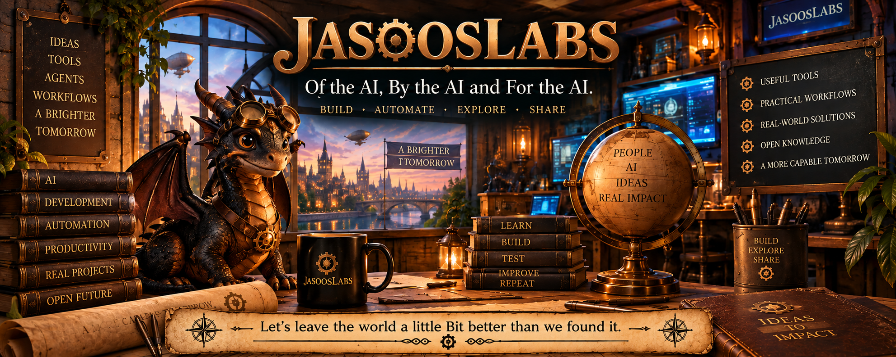

# JasoosLabs

## Of the AI, By the AI and For the AI.

JasoosLabs is an independent software studio exploring practical ways to make AI, automation, and everyday computing more useful.

The emphasis is not AI for its own sake. We build tools, workflows, experiments, and learning material intended to turn emerging technology into things people can actually use.

**Build • Automate • Explore • Share**

---

## What We Build

JasoosLabs projects explore areas such as:

- AI-assisted software development
- agentic AI workflows
- human-in-the-loop AI
- reusable workflow automation
- developer productivity
- Windows utilities
- personal computing tools
- music and media technology
- practical experiments with emerging AI capabilities

Some projects become applications. Others become experiments, tutorials, reusable workflows, or research.

---

## Our Released Products

1. [TTS Voice Showdown](#tts-voice-showdown)
2. [Windows Dev Starter Kit — PowerShell Edition](#windows-dev-starter-kit--powershell-edition)
3. [NovaInsert](#novainsert)

---

## TTS Voice Showdown

### Hear the difference before choosing a narration voice

Choosing a voice from a name or sample clip can be misleading. TTS Voice Showdown lets you hear AI voices, cloned voices, and the author’s recorded voice read the **same passage**, so you can compare how they actually sound for video narration.

Choose one of three passages, select up to three voices, and play them individually or together. Compare the voices side by side and decide which fits your video.

**What’s included:** 17 recordings from 10 sources: commercial and Windows voices, open models, voice clones, and the author’s recording. Links identify the source or model behind each recording group.

**TTS Voice Showdown helps you choose by listening and comparing—not by guessing from a voice label.**

- [Open the live PWA](https://jasoos-labs.github.io/tts-voice-showdown/)
- [View the source repository](https://github.com/jasoos-labs/tts-voice-showdown)

---

## Windows Dev Starter Kit — PowerShell Edition

### Spend less effort remembering the chores around your project

Every project comes with a familiar set of small jobs: find a file, inspect changes, package source, apply an update, build, test, and run. Remembering which command does what—and how to do it consistently—can become its own task.

**Windows Dev Starter Kit gives those chores a simple, repeatable command set.** Short commands help you inspect a project, search files and text, check Git status, and follow a build-test-run cycle from PowerShell.

**`bld` → `tst` → `run`**  
Or use **`go`** to build, test, and run in sequence, stopping when a step fails.

It’s a beginner-friendly personal toolkit for working with projects under Windows development folders. It complements the tools you already use; it isn’t meant to replace experienced developers’ established workflows.

- [View the public repository](https://github.com/jasoos-labs/windows-dev-starter-kit-powershell)

---

## NovaInsert

### Put augmented and agentic AI to work—with structure

AI can help explore ideas, build solutions, and handle work in the background. But every task still needs clear direction, useful context, and a way to check the result.

**NovaInsert gives you a repeatable way to manage that work.** Use the **4E Value Chain** to move from exploring a possibility to realizing value. Use the **5E Solution Chain** to take each task from understanding the need through evidence, engineering, evaluation, and delivery.

Prepare the instructions and tools for a project, give the task to AI, step away while it works, then return to verify the result. Reuse what works instead of reconstructing your workflow each time. NovaInsert also helps with the commands and repetitive computer tasks around your AI work.

**Prepare → Delegate → Leave → Return → Verify**

You direct the work and remain accountable for the result. NovaInsert helps make the process organized and repeatable.

**Library Insert Sets (LIS)** organize reusable prompts, instructions, procedures, commands, checks, and keyboard actions by project, ready to send to the application where the work happens. **Hideout** keeps selected protected information separate from ordinary workflow material.

NovaInsert is a Windows tool for human-directed AI workflows and everyday computer tasks. It facilitates agentic work; it is not an autonomous AI agent.

- [Get NovaInsert downloads and release notes](https://github.com/jasoos-labs/releases)
- [View the NovaInsert repository](https://github.com/jasoos-labs/NovaInsert) (private source repository)

---

## Explore

JasoosLabs is also a place for experimentation.

Not every useful idea begins as a product.

We explore technologies, build probes, test assumptions, document what works and what does not, and turn useful discoveries into software or reusable knowledge.

The process matters as much as the finished application.

---

## Share

Useful work should be explainable.

JasoosLabs projects are accompanied, where practical, by guides, examples, demonstrations, and tutorials so that others can understand not only what was built, but how and why it works.

---

## JasoosLabs

**Of the AI, By the AI and For the AI.**

**Let's leave the world a little bit better than we found it.**
